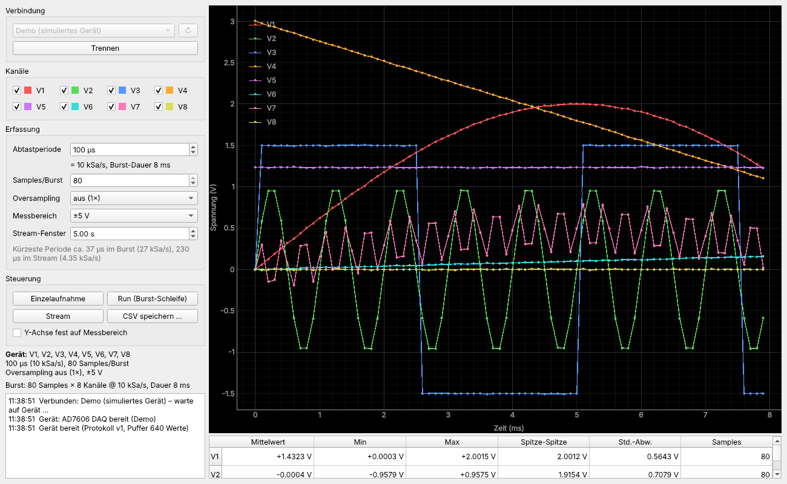
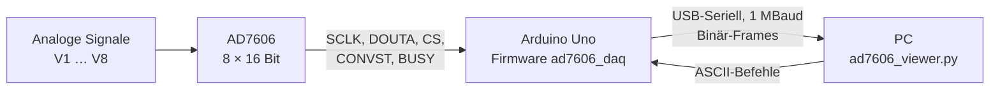

# Arduino ADC Plotter – AD7606 + Arduino Uno + PC-Viewer

Messwerterfassung mit dem 8-Kanal-ADC **AD7606** (16 Bit, simultanes Sampling) an einem **Arduino Uno**.
Ein PC-Programm für **Linux und Windows** stellt die Messdaten live dar.



## Funktionen

- 8 Kanäle mit 16 Bit, alle **im selben Moment** abgetastet, Messbereich ±5 V oder ±10 V
- **Burst-Modus:** schnelle Aufnahme ins RAM des Uno, danach Übertragung zum PC
  (bis ca. 27 kSa/s bei 8 Kanälen, maximal 640 Messwerte pro Aufnahme)
- **Run-Modus:** Burst-Aufnahmen in Endlosschleife, wie ein Oszilloskop ohne Trigger
- **Stream-Modus:** kontinuierliche Übertragung ohne Längenbegrenzung (ca. 4 kSa/s bei 8 Kanälen)
- Abtasttakt aus einem Hardware-Timer, Erkennung zu kurzer Perioden (Overruns)
- Oversampling 1× bis 64× über den digitalen Filter des AD7606
- PC-Viewer mit Live-Plot, Statistik je Kanal, CSV-Export und **Demo-Modus ohne Hardware**

## Systemüberblick



## Projektstruktur

```
firmware/
  ad7606_daq/ad7606_daq.ino          Firmware für den Viewer (Burst + Stream, Binärprotokoll)
  ad7606_serial/ad7606_serial.ino    Minimaler Test-Sketch mit Textausgabe im Serial Monitor
viewer/
  ad7606_viewer.py                   PC-Programm (Python, PySide6, pyqtgraph)
  requirements.txt
docs/                                Ausführliche Dokumentation
```

## Schnellstart

1. **Hardware anschließen.** Siehe [docs/hardware.md](docs/hardware.md). Das AD7606-Modul muss auf
   **seriellen Modus** eingestellt sein; viele Module sind ab Werk auf parallel gestellt.
2. **Optional:** `firmware/ad7606_serial` flashen und im Serial Monitor (115200 Baud) prüfen,
   ob plausible Spannungen ankommen. Ein Eingang auf GND sollte ≈ 0 V zeigen.
3. **Firmware:** `firmware/ad7606_daq` mit der Arduino-IDE auf den Uno laden (Board *Arduino Uno*).
4. **PC-Programm** installieren und starten (Python ≥ 3.9):
   ```bash
   cd viewer
   python -m venv .venv
   source .venv/bin/activate          # Windows: .venv\Scripts\activate
   pip install -r requirements.txt
   python ad7606_viewer.py            # ohne Hardware: python ad7606_viewer.py --demo
   ```
5. Port auswählen, **Verbinden** klicken, dann **Einzelaufnahme**, **Run** oder **Stream**.

Unter Linux braucht der Benutzer Zugriff auf den seriellen Port:
`sudo usermod -aG dialout $USER`, danach ab- und wieder anmelden.

## Dokumentation

| Dokument | Inhalt |
|---|---|
| [Hardware](docs/hardware.md) | AD7606 im Überblick, Verdrahtung, Modul-Einstellungen, Versorgung, Eingänge |
| [Firmware](docs/firmware.md) | Aufbau, Abtasttakt mit Timer1, Ablauf einer Wandlung, RAM-Budget, Portierung |
| [Protokoll](docs/protokoll.md) | Befehle PC → Uno, Binär-Frames Uno → PC, Beispiele mit Hex-Dumps |
| [PC-Programm](docs/pc-programm.md) | Installation, Bedienung, Architektur, Erweiterungen |
| [Leistung und Grenzen](docs/leistung-und-grenzen.md) | Abtastraten, Engpässe, Aliasing, Oversampling, Alternativen zum Uno |
| [Fehlersuche](docs/fehlersuche.md) | Typische Fehlerbilder und ihre Ursachen |
| [Entstehung (Prompts)](docs/prompts.md) | Die Prompts, mit denen das Projekt zusammen mit Claude entstanden ist, und was jeweils dabei herauskam |

## Projektstatus

- Beide Sketches kompilieren für den ATmega328P ohne Warnungen.
  `ad7606_daq`: 6,0 KB Flash, 1522 Byte RAM (74 %).
- Das PC-Programm ist mit dem eingebauten Demo-Gerät getestet: Burst, Run, Stream,
  Overrun-Erkennung und Neusynchronisation nach Übertragungsfehlern.
- **Mit echter Hardware ist das Projekt noch nicht getestet.** Alle Angaben zu Abtastraten
  sind aus Datenblatt und Taktzyklen berechnete Schätzungen, keine Messungen.
