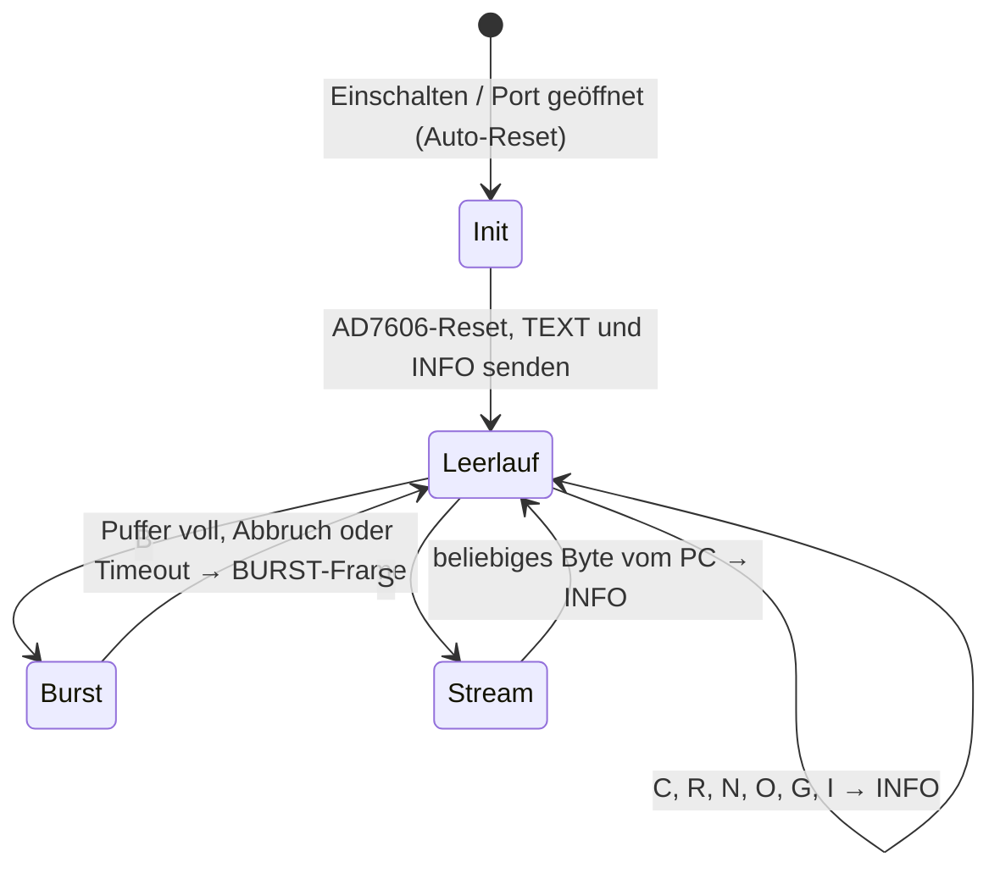

# Firmware

Im Ordner `firmware/` liegen zwei Sketches:

| Sketch | Zweck |
|---|---|
| `ad7606_serial` | Minimaler Test: misst alle 8 Kanäle etwa 5-mal pro Sekunde und gibt Volt-Werte als Text aus (Serial Monitor, 115200 Baud). Für die erste Inbetriebnahme der Hardware. |
| `ad7606_daq` | Die eigentliche Firmware für den PC-Viewer: Burst- und Stream-Modus, Timer-gesteuerter Abtasttakt, Binärprotokoll mit 1 MBaud. |

Dieses Dokument beschreibt `ad7606_daq`.

## Kompilieren und Hochladen

**Arduino-IDE:** `firmware/ad7606_daq/ad7606_daq.ino` öffnen, Board *Arduino Uno* wählen, hochladen.
Die IDE verlangt, dass der Ordner so heißt wie der Sketch. Deshalb liegt jede `.ino` in einem
eigenen Ordner.

**arduino-cli:**
```bash
arduino-cli core install arduino:avr
arduino-cli compile --fqbn arduino:avr:uno firmware/ad7606_daq
arduino-cli upload  --fqbn arduino:avr:uno -p /dev/ttyACM0 firmware/ad7606_daq   # Windows: -p COM3
```

Der Viewer muss beim Hochladen getrennt sein, weil sonst der Port belegt ist.

## Zustandsautomat



Im Leerlauf sammelt `loop()` eingehende Zeichen in einem 24-Byte-Zeilenpuffer. Bei `\n` oder
`\r` wird die Zeile an `execCommand()` übergeben. Die Befehle sind in
[protokoll.md](protokoll.md#befehle-pc--uno) beschrieben.

## Abtasttakt mit Timer1

Ein gleichmäßiger Abtastabstand ist die Voraussetzung dafür, dass die Zeitachse stimmt. Eine
Schleife mit `delayMicroseconds()` oder `micros()` taugt dafür nicht, weil sich die Laufzeit
des Codes zur Periode addiert und `micros()` nur in 4-µs-Schritten zählt.

Die Firmware betreibt deshalb **Timer1 im CTC-Modus** (Clear Timer on Compare Match). Der Zähler
läuft bis `OCR1A`, setzt dann das Flag `OCF1A` und beginnt wieder bei 0. Der Takt entsteht also in
Hardware, unabhängig davon, wie lange die Software für ein Sample braucht.

```cpp
void timerStart() {
  TCCR1B = 0; TCCR1A = 0; TCNT1 = 0;
  OCR1A  = tmrOcr;
  TIFR1  = _BV(OCF1A);                // altes Flag löschen (durch Schreiben einer 1)
  TCCR1B = _BV(WGM12) | tmrCs;        // CTC-Modus, Timer läuft
}

inline void waitTick() { while (!(TIFR1 & _BV(OCF1A))) {} TIFR1 = _BV(OCF1A); }
```

### Prescaler und Rundung

`OCR1A` ist 16 Bit breit. `setPeriod()` wählt den kleinsten Prescaler, bei dem die gewünschte
Periode noch hineinpasst:

| Periode | Prescaler | Zeitraster | OCR1A |
|---|---|---|---|
| 10 µs … 32,768 ms | 8 | 0,5 µs | 2 · T − 1 |
| … 262,144 ms | 64 | 4 µs | T / 4 − 1 |
| … 1,048576 s | 256 | 16 µs | T / 16 − 1 |
| … 4 s | 1024 | 64 µs | T / 64 − 1 |

Perioden über 32,768 ms werden auf das jeweilige Raster abgerundet. Die tatsächliche Periode
steht im INFO-Frame. Der Viewer rechnet die Rundung mit `quantize_period()` nach und zeigt sie an.

### Warum Flag-Polling statt Interrupt?

- Während einer Aufnahme hat der Prozessor nichts anderes zu tun. Ein Interrupt würde nur die
  Reaktionszeit verlängern (Register sichern, Sprung), ohne Rechenzeit freizugeben.
- Die Wartezeit ist beim Polling sehr konstant: Die Schleife besteht aus wenigen Befehlen, die
  Verzögerung zwischen Timer-Ereignis und CONVST-Flanke schwankt nur um wenige Taktzyklen.

### Weitere Jitter-Quellen abgestellt

```cpp
Serial.flush();          // laufende Sendungen abwarten -> kein UART-Interrupt mitten in der Aufnahme
uint8_t timsk0 = TIMSK0;
TIMSK0 = 0;              // Timer0-Overflow (millis/micros) aus, sonst alle 1,024 ms ein ~5-µs-Interrupt
...
TIMSK0 = timsk0;         // nach der Aufnahme wiederherstellen
```

`millis()` und `micros()` bleiben während einer Aufnahme stehen. Deshalb verwendet `adcConvert()`
für den BUSY-Timeout einen Schleifenzähler statt `micros()`.

Im Stream-Modus erzeugt das Senden selbst UART-Interrupts (einer pro Byte). Dort ist der Jitter
deshalb etwas größer als im Burst-Modus.

## Ablauf eines Samples

```
Timer1   ──┐ OCF1A
CONVST   ‾‾‾\_/‾‾‾‾‾‾‾‾‾‾‾‾‾‾‾‾‾‾‾‾‾‾‾‾‾‾‾‾‾‾‾‾‾‾‾‾‾‾‾‾‾‾‾‾‾‾‾‾‾
BUSY     ______/‾‾‾‾‾‾‾‾‾‾\_______________________________________
CS       ‾‾‾‾‾‾‾‾‾‾‾‾‾‾‾‾‾‾‾‾\______________________________/‾‾‾‾
SCLK     ‾‾‾‾‾‾‾‾‾‾‾‾‾‾‾‾‾‾‾‾‾‾\_/\_/\_/\_/ … \_/\_/\_/‾‾‾‾‾‾‾‾‾‾‾
DOUTA                          V1[15:0]  V2[15:0] … Vn[15:0]
                 |<- 4 µs ->|      |<--- n × ca. 3,5 µs --->|
```

### 1. Wandlung starten und abwarten

```cpp
bool adcConvert() {
  CONVST_LOW();
  __asm__ __volatile__("nop\n\tnop\n\t");   // > 25 ns LOW
  CONVST_HIGH();                             // steigende Flanke startet alle 8 Kanäle gleichzeitig

  uint16_t n = 0;                            // ein Durchlauf ≈ 0,35 µs -> Timeout ≈ 23 ms
  while (!BUSY_IS_HIGH()) if (++n == 0) return false;
  n = 0;
  while (BUSY_IS_HIGH())  if (++n == 0) return false;
  return true;
}
```

- `CONVST_LOW()` usw. sind Makros für direkte Portzugriffe (`PORTD &= ~_BV(PD7)`). Der Compiler
  macht daraus jeweils einen einzigen `cbi`/`sbi`-Befehl (125 ns). `digitalWrite()` bräuchte
  rund 4 µs.
- Die erste Schleife wartet, bis BUSY HIGH wird, also bis der Chip die Wandlung tatsächlich
  begonnen hat. Ohne sie könnte man noch den LOW-Pegel von **vor** dem Start lesen und die
  Wandlung für beendet halten.
- Die zweite Schleife wartet auf das Ende: 4 µs ohne Oversampling, bis etwa 315 µs bei 64×.
- Läuft ein Zähler über (≈ 23 ms), liefert die Funktion `false` und die Firmware meldet
  „BUSY-Timeout“.

### 2. Ergebnisse auslesen

```cpp
int16_t* adcRead(int16_t* dst, uint8_t mask, uint8_t lastCh) {
  CS_LOW();
  for (uint8_t ch = 0; ch < lastCh; ch++) {
    int16_t v = (int16_t)SPI.transfer16(0);
    if (mask & (1 << ch)) *dst++ = v;
  }
  CS_HIGH();
  return dst;
}
```

- Nach `CS_LOW()` liegt das MSB von V1 an DOUTA. Jeder `transfer16()` taktet 16 Bit heraus.
- Bei nur einer Datenleitung (DOUTA) gibt der AD7606 die Kanäle **in fester Reihenfolge**
  V1, V2, … aus. Um V5 zu lesen, müssen V1 bis V4 vorher durchgetaktet werden.
  `lastCh` ist deshalb der höchste aktive Kanal; bei der Maske `0b00000101` (V1, V3) werden
  nur V1 bis V3 gelesen und V2 verworfen.
- **SPI-Modus 3** (CPOL = 1, CPHA = 1): SCLK ruht HIGH, der AD7606 gibt das nächste Bit mit der
  fallenden Flanke aus, der Uno liest mit der steigenden.
- Der Cast `(int16_t)` macht aus dem vorzeichenlosen Rückgabewert die Zweierkomplement-Zahl
  des ADC (`0xFFFF` → −1).

## Overrun-Erkennung

Ist die Periode kürzer als Wandlung, Auslesen und (im Stream) Senden zusammen, wird das nächste
Sample zu spät gestartet. Die Firmware erkennt das daran, dass das Timer-Flag beim Ende der
Verarbeitung **bereits wieder gesetzt** ist:

```cpp
if (tickPending()) overruns++;    // nächster Takt schon vorbei -> Periode zu kurz
```

Im Burst-Modus wird die Anzahl im Header des BURST-Frames gemeldet, im Stream-Modus über Bit 0
des `flags`-Bytes jedes Frames. Mehrere verpasste Takte hintereinander zählen dabei nur einfach.
Die Daten sind trotzdem gültig, nur stimmt die Zeitachse nicht mehr exakt.

## Burst-Modus

1. Sendepuffer leeren, Timer0-Interrupt aus, SPI-Transaktion beginnen, Timer1 starten.
2. Für jedes Sample: auf den Takt warten, wandeln, auslesen, in `buf[]` ablegen, auf Overrun
   prüfen.
3. Kommt währenddessen ein Byte vom PC an, bricht die Aufnahme nach dem aktuellen Sample ab.
4. BURST-Frame mit allen bisher aufgenommenen Samples senden.

Die Anzahl Samples ist auf `640 / Kanalzahl` begrenzt: 80 bei 8 Kanälen, 640 bei einem Kanal.

## Stream-Modus

Jedes Sample wird sofort als eigenes STREAM-Frame gesendet. `Serial.write()` legt die Bytes in
den 64-Byte-Sendepuffer und **blockiert, wenn dieser voll ist**. Ist die gewünschte Rate höher
als die serielle Verbindung schafft, bremst das die Schleife automatisch aus. Die verspäteten
Samples werden dann als Overrun markiert.

Der Stream endet, sobald ein beliebiges Byte vom PC ankommt (der Viewer sendet `X`).
Danach sendet die Firmware ein INFO-Frame als Bestätigung.

## RAM-Budget

Der ATmega328P hat 2048 Byte RAM.

| Verwendung | Byte |
|---|---|
| Messpuffer `buf[640]` | 1280 |
| `HardwareSerial` (je 64 Byte Sende- und Empfangspuffer + Verwaltung) | ca. 160 |
| Restliche globale Variablen (Konfiguration, Zeilenpuffer, Arduino-Core) | ca. 80 |
| **Statisch belegt** (`.data` + `.bss`) | **1522 (74 %)** |
| Frei für den Stack | ca. 526 |

Mehr Puffer ist kaum möglich: Ab 75 % warnt die Arduino-IDE vor Stabilitätsproblemen, und der
Stack braucht im Stream-Modus (Frame-Funktionen, `pkt`-Struktur) einige Dutzend Byte. Feste Texte
liegen über `PSTR()` im Flash und belegen kein RAM.

## Portierung

Folgende Teile sind spezifisch für den ATmega328P bei 16 MHz und müssen auf anderen Boards ersetzt
werden:

| Stelle | Inhalt | Ersatz auf anderen Plattformen |
|---|---|---|
| Makros `CONVST_LOW()`, `CS_LOW()`, `BUSY_IS_HIGH()` … | direkte Zugriffe auf PORTB/PORTD/PIND | GPIO-Register des Zielchips oder `digitalWriteFast` |
| `setPeriod()`, `timerStart()`, `waitTick()` | Timer1-Register | Hardware-Timer oder PWM-Kanal des Zielchips |
| `TIMSK0 = 0` | Timer0-Interrupt abschalten | entfällt oder Äquivalent |
| `BAUD = 1000000` | bei 16 MHz exakt erreichbar | bei nativem USB (RP2040, ESP32-S3, STM32) bedeutungslos |
| `BUF_WORDS = 640` | durch 2 KB RAM begrenzt | deutlich größer möglich |

Auf einem Arduino Nano oder Pro Mini (ebenfalls ATmega328P, 16 MHz) läuft die Firmware unverändert.
Ein Arduino Mega (ATmega2560) hat andere Port-Zuordnungen für die SPI-Pins.
