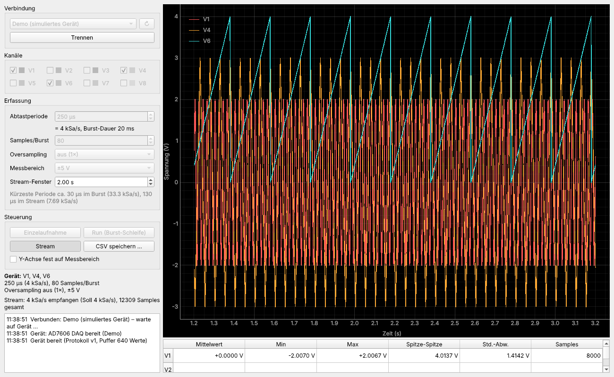
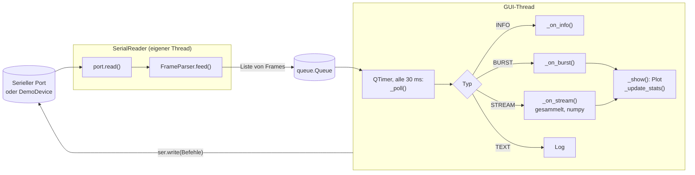

# PC-Programm `ad7606_viewer.py`

Grafische Oberfläche zur Steuerung der Firmware und zur Darstellung der Messdaten.
Python mit **PySide6** (Qt 6), **pyqtgraph** für schnelle Plots, **pyserial** und **numpy**.
Läuft unter Windows und Linux, macOS sollte ebenfalls funktionieren.

## Installation

### Windows

1. Python ≥ 3.9 von python.org installieren, dabei „Add python.exe to PATH“ anhaken.
2. Im Ordner `viewer`:
   ```bat
   py -m venv .venv
   .venv\Scripts\activate
   pip install -r requirements.txt
   ```

### Linux

```bash
cd viewer
python3 -m venv .venv            # Debian/Ubuntu: ggf. vorher  sudo apt install python3-venv
source .venv/bin/activate
pip install -r requirements.txt
sudo usermod -aG dialout $USER   # Zugriff auf /dev/ttyACM0, danach neu anmelden
```

Meldet Qt beim Start *„Could not load the Qt platform plugin "xcb"“*, fehlt eine Systembibliothek.
Unter Debian/Ubuntu hilft `sudo apt install libxcb-cursor0`.

### Start

```bash
python ad7606_viewer.py           # mit Hardware
python ad7606_viewer.py --demo    # mit simuliertem Gerät, verbindet sich automatisch
```

## Bedienung



### Linke Spalte

| Bereich | Element | Funktion |
|---|---|---|
| **Verbindung** | Port-Auswahl, ↻ | Serielle Ports des Systems plus „Demo (simuliertes Gerät)“. Ports, die nach Arduino, CH340 oder USB aussehen, werden vorausgewählt. |
| | Verbinden / Trennen | Öffnet den Port mit 1 MBaud. Die Bedienelemente werden erst freigegeben, wenn das Gerät sein erstes INFO-Frame geschickt hat. |
| **Kanäle** | V1 … V8 | Welche Kanäle aufgenommen werden. Mindestens einer bleibt immer aktiv. Weniger Kanäle bedeuten mehr Samples pro Burst und höhere Raten. |
| **Erfassung** | Abtastperiode | 10 µs … 4 s. Darunter stehen die resultierende Rate, die Burst-Dauer und ggf. die Rundung durch den Timer. |
| | Samples/Burst | Maximum passt sich der Kanalzahl an (640 / Kanäle). |
| | Oversampling | 1× bis 64×. Mittelt im AD7606 mehrere Wandlungen pro Ergebnis: weniger Rauschen, aber längere Wandlungszeit. |
| | Messbereich | ±5 V oder ±10 V. |
| | Stream-Fenster | Wie viele Sekunden im Stream-Modus sichtbar bleiben (0,1 … 30 s). Auch während des Streams änderbar. |
| | Schätzung | Kürzeste sinnvolle Periode für Burst und Stream mit den aktuellen Einstellungen. Wird rot, wenn die eingestellte Periode darunter liegt. |
| **Steuerung** | Einzelaufnahme | Sendet die Konfiguration und einen Burst-Befehl, zeigt das Ergebnis an. |
| | Run | Startet nach jedem empfangenen Burst sofort den nächsten. Ausschalten beendet die Schleife nach dem laufenden Burst. |
| | Stream | Kontinuierliche Übertragung. Während Run und Stream sind die Einstellungen gesperrt. |
| | CSV speichern | Speichert die gerade angezeigten Daten. |
| | Y-Achse fest | Skaliert auf den vollen Messbereich statt automatisch auf das Signal. |
| **Status** | Gerät | Konfiguration laut letztem INFO-Frame, also das, was der Uno tatsächlich verwendet. |
| | Erfassung | Burst: Samples, Rate, Dauer, Overruns. Stream: empfangene Rate (gemessen), Sollrate, verspätete Samples. |
| | Log | Meldungen des Geräts (TEXT-Frames), Verbindungsereignisse, Fehler. |

### Plot

pyqtgraph-Standardbedienung:

- **Mausrad:** zoomen, **linke Maustaste ziehen:** verschieben,
  **rechte Maustaste ziehen:** Achsen getrennt skalieren
- **„A“-Knopf** unten links: zurück zur automatischen Skalierung
- **Rechtsklick:** Kontextmenü mit „View All“ und „Export…“ (PNG, SVG, CSV)

Bei höchstens 300 Samples werden die einzelnen Messpunkte als Marker gezeichnet, damit man die
tatsächliche Abtastung sieht. Lange Streams werden beim Zeichnen per Peak-Downsampling reduziert;
dabei bleiben Spitzen sichtbar, die Statistik nutzt trotzdem alle Werte.

### Statistik-Tabelle

Für jeden aktiven Kanal über die angezeigten Daten (Burst: ganze Aufnahme, Stream: aktuelles
Fenster): Mittelwert, Minimum, Maximum, Spitze-Spitze, Standardabweichung und Anzahl Samples.
Die Standardabweichung eines konstanten Eingangs (z. B. auf GND) ist ein direktes Maß für das
Rauschen der Messkette.

### CSV-Format

```
t_s,V1_V,V4_V,V6_V
0,0.0021,2.9987,0.0024
0.00025,0.1571,2.9412,0.0052
…
```

Zeit in Sekunden ab Beginn der Aufnahme, Spannungen in Volt, Komma als Trennzeichen, Punkt als
Dezimalzeichen. In einem deutschen Excel über *Daten → Aus Text/CSV* importieren, sonst landet
alles in einer Spalte.

## Architektur



### Klassen

| Klasse | Aufgabe |
|---|---|
| `FrameParser` | Zerlegt den Bytestrom in Frames, prüft Länge und Prüfsumme und synchronisiert sich nach Fehlern neu. Zählt verworfene Frames. |
| `SerialReader` | Thread, der ununterbrochen vom Port liest und fertige Frames in die Queue legt. Meldet Verbindungsfehler (z. B. abgezogenes Kabel) ebenfalls über die Queue. |
| `DemoDevice` | Simuliert die Firmware einschließlich Protokoll, Rundung der Periode, Bandbreitenlimit und Overrun-Flags. Bietet dieselbe Schnittstelle wie `serial.Serial` (`read`, `write`, `in_waiting`, `close`). |
| `Rolling` | Ringpuffer für den Stream, der die letzten N Zeilen als zusammenhängendes numpy-Array liefert, ohne bei jedem Zeichnen zu kopieren. |
| `MainWindow` | Oberfläche, Verbindungsverwaltung, Auswertung der Frames, Plot, Statistik, CSV. |

### Entwurfsentscheidungen

**Lesen in einem eigenen Thread.** Die serielle Schnittstelle wird nie im GUI-Thread gelesen.
Ein langsamer Bildaufbau kann so keine Daten verlieren lassen, und ein hängender Port friert die
Oberfläche nicht ein.

**Queue mit Polling statt Qt-Signal pro Frame.** Im Stream-Modus kommen bis zu ~11 000 Frames pro
Sekunde. Ein Qt-Signal pro Frame würde die Ereignisschleife überlasten. Stattdessen holt die GUI
alle 30 ms alles ab, was sich angesammelt hat, und verarbeitet die STREAM-Frames gebündelt.

**Vektorisierte Stream-Auswertung.** Alle STREAM-Nutzdaten eines Durchlaufs werden aneinandergehängt
und mit numpy in einem Schritt zerlegt:

```python
arr  = np.frombuffer(blob, np.uint8).reshape(-1, 1 + 2 * nch)   # eine Zeile pro Frame
flags = arr[:, 0]
vals  = np.ascontiguousarray(arr[:, 1:]).view("<i2") * (fs / 32768.0)
```

**Ringpuffer mit doppelter Größe.** `Rolling` reserviert 2·N Zeilen und schreibt fortlaufend.
Erst wenn das Ende erreicht ist, werden die letzten N Zeilen einmal nach vorne kopiert. Die Sicht
auf die letzten N Zeilen ist immer ein zusammenhängender Ausschnitt ohne Kopie.

**Konfiguration bei jedem Start mitsenden.** Vor jedem `B` und `S` schickt der Viewer die komplette
Konfiguration (`C`, `R`, `N`, `O`, `G`). Gerät und Oberfläche können dadurch nicht auseinanderlaufen,
auch nicht nach einem Reset des Uno. Die quittierenden INFO-Frames zeigen, was das Gerät
tatsächlich eingestellt hat.

**Demo-Gerät auf Protokollebene.** `DemoDevice` erzeugt echte Bytes im Protokollformat. Damit
testet der Demo-Modus nicht nur die Oberfläche, sondern auch Parser und Auswertung.
Die Testsignale: V1 Sinus 50 Hz, V2 Sinus 1 kHz, V3 Rechteck 200 Hz, V4 Dreieck 20 Hz,
V5 Gleichspannung 1,234 V, V6 Sägezahn 5 Hz, V7 50 Hz + 3 kHz, V8 nur Rauschen.
Bei niedrigen Abtastraten zeigen V2 und V7 deutlich, was [Aliasing](leistung-und-grenzen.md#aliasing)
bedeutet.

## Ausführbare Datei erzeugen

```bash
pip install pyinstaller
pyinstaller --onefile --windowed --name AD7606-Viewer ad7606_viewer.py
```

Das Ergebnis liegt in `dist/`. PyInstaller erzeugt keine Cross-Builds: Die `.exe` für Windows muss
unter Windows gebaut werden, das Linux-Programm unter Linux.

## Erweiterungsideen

- **Trigger:** In der Firmware einen Ringpuffer laufen lassen und erst nach Über- oder Unterschreiten
  eines Pegels die restlichen Samples aufnehmen. Ergibt stehende Kurven im Run-Modus wie bei einem
  Oszilloskop.
- **FFT-Ansicht:** `numpy.fft.rfft` über die Burst-Daten mit Fensterfunktion, als zweiter Plot.
- **Kalibrierung:** Offset und Verstärkung pro Kanal einmal gegen eine Referenzspannung bestimmen
  und in der Umrechnung berücksichtigen.
- **Kontinuierliche Aufzeichnung auf Platte:** Stream-Daten zusätzlich fortlaufend in eine Datei
  schreiben, statt nur das sichtbare Fenster als CSV zu speichern.
