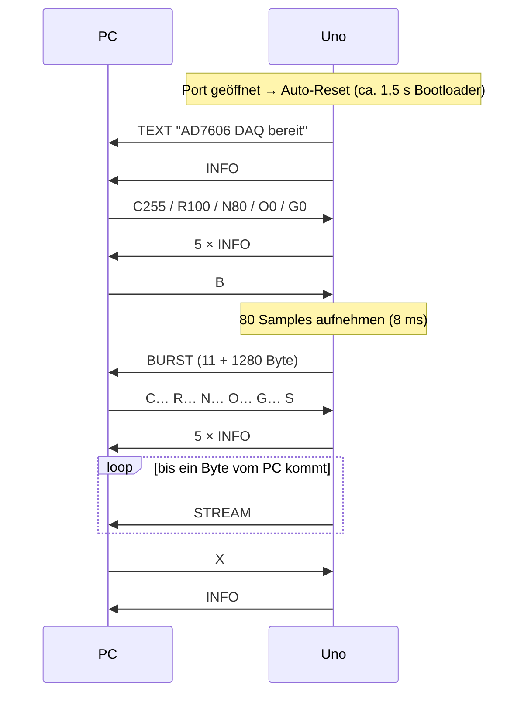

# Protokoll

Die Verbindung zwischen Uno und PC läuft über den USB-Seriell-Wandler des Uno mit
**1 000 000 Baud, 8N1**. Die beiden Richtungen sind unterschiedlich aufgebaut:

- **PC → Uno:** kurze ASCII-Befehle. Man kann sie auch von Hand im Serial Monitor eintippen.
- **Uno → PC:** Binär-Frames mit Synchronisationsmuster und Prüfsumme. Binär, weil Text die
  Datenmenge etwa verdreifachen würde und die Bandbreite der eigentliche Engpass ist.

Warum 1 MBaud? Bei 16 MHz Takt ist 1 MBaud exakt einstellbar (UBRR = 1 mit U2X). Die übliche
Rate 115200 Baud liegt dagegen 2,1 % neben dem Sollwert und ist fast neunmal langsamer.

## Befehle PC → Uno

Jeder Befehl ist eine Zeile, abgeschlossen mit `\n` (auch `\r` oder `\r\n` funktionieren).
Zahlen werden mit `strtoul(…, 0)` gelesen, `0x…` für Hexadezimal ist also erlaubt.

| Befehl | Bedeutung | Wertebereich | Antwort |
|---|---|---|---|
| `C<maske>` | Kanalmaske, Bit 0 = V1 … Bit 7 = V8 | 1 … 255 (0 wird zu 1) | INFO |
| `R<µs>` | Abtastperiode in µs | 10 … 4 000 000, wird gerundet | INFO |
| `N<anzahl>` | Samples pro Burst | 1 … 640 / Kanalzahl | INFO |
| `O<n>` | Oversampling-Faktor 2^n | 0 … 6 | INFO |
| `G<0\|1>` | Messbereich ±5 V / ±10 V | 0, 1 | INFO |
| `I` | aktuelle Konfiguration abfragen | – | INFO |
| `B` | Burst-Aufnahme starten | – | BURST |
| `S` | Stream starten | – | STREAM-Frames, am Ende INFO |
| `X` | Stream beenden (im Leerlauf ignoriert) | – | – |

Beispiele: `C255` (alle Kanäle), `C0x0F` (V1–V4), `R100` (10 kSa/s), `N80`, `O2` (4× Oversampling).

**Abbruch:** Während Burst oder Stream beendet **jedes** empfangene Byte die Erfassung. Deshalb
entfernt die Firmware direkt nach `B` bzw. `S` noch ein eventuell folgendes `\r`/`\n`, damit ein
Zeilenende vom Serial Monitor die Erfassung nicht sofort wieder stoppt.

## Frames Uno → PC

### Aufbau

| Offset | Größe | Inhalt |
|---|---|---|
| 0 | 2 | Synchronisationsmuster `0xA5 0x5A` |
| 2 | 1 | Typ |
| 3 | 2 | Länge L der Nutzdaten (uint16, little endian) |
| 5 | L | Nutzdaten |
| 5 + L | 1 | Prüfsumme: Summe aller Bytes von Offset 2 bis 4 + L, modulo 256 |

Alle Mehrbyte-Werte sind **little endian**, wie sie im AVR-Speicher liegen. Messwerte sind
`int16` im Zweierkomplement, direkt vom ADC übernommen.

### Typ 1 – INFO (12 Byte)

Antwort auf jeden Einstellbefehl, auf `I`, nach dem Start und nach dem Ende eines Streams.

| Offset | Typ | Feld | Bedeutung |
|---|---|---|---|
| 0 | u8 | proto | Protokollversion, derzeit 1 |
| 1 | u16 | bufWords | Größe des Messpuffers in Werten (640) |
| 3 | u8 | mask | aktive Kanäle |
| 4 | u32 | periodUs | tatsächliche (gerundete) Abtastperiode |
| 8 | u16 | nsets | Samples pro Burst |
| 10 | u8 | os | Oversampling-Exponent |
| 11 | u8 | range | 0 = ±5 V, 1 = ±10 V |

### Typ 2 – BURST (11 Byte Kopf + Daten)

| Offset | Typ | Feld | Bedeutung |
|---|---|---|---|
| 0 | u8 | mask | Kanäle dieser Aufnahme |
| 1 | u32 | periodUs | Abtastperiode |
| 5 | u16 | nsets | Anzahl Samples **tatsächlich** aufgenommen (kleiner bei Abbruch/Timeout) |
| 7 | u8 | os | Oversampling-Exponent |
| 8 | u8 | range | Messbereich |
| 9 | u16 | overruns | Anzahl verspäteter Samples |
| 11 | i16[ ] | Daten | nsets × Kanalzahl Werte, nach Samples verschachtelt |

Reihenfolge der Daten bei aktiven Kanälen V1, V3: `S0·V1, S0·V3, S1·V1, S1·V3, …`

Der Zeitpunkt von Sample k ist `k · periodUs`. Das größte BURST-Frame hat 11 + 1280 = 1291 Byte
Nutzdaten.

### Typ 3 – STREAM (1 + 2·n Byte)

| Offset | Typ | Feld | Bedeutung |
|---|---|---|---|
| 0 | u8 | flags | Bit 0 = dieses Sample wurde zu spät gestartet |
| 1 | i16[n] | Daten | ein Wert pro aktivem Kanal, aufsteigend |

Kanalmaske, Periode und Messbereich stehen nicht im Frame. Sie stammen aus dem letzten INFO-Frame
vor dem Stream. Die Kanalzahl ergibt sich auch aus der Länge: n = (L − 1) / 2.

### Typ 4 – TEXT

ASCII-Meldung ohne Nullterminierung, z. B. `AD7606 DAQ bereit` oder
`BUSY-Timeout: Verdrahtung/STBY pruefen`.

## Umrechnung in Volt

```
U = code · FS / 32768        FS = 5 V (range = 0) oder 10 V (range = 1)
```

| Code | ±5 V | ±10 V |
|---|---|---|
| 32767 (`0x7FFF`) | +4,99985 V | +9,99969 V |
| 16384 (`0x4000`) | +2,5 V | +5 V |
| 1 | +152,6 µV | +305,2 µV |
| 0 | 0 V | 0 V |
| −32768 (`0x8000`) | −5 V | −10 V |

## Beispiele

**INFO nach dem Start** (alle Kanäle, 100 µs, 80 Samples, kein Oversampling, ±5 V):

```
A5 5A  01  0C 00  01  80 02  FF  64 00 00 00  50 00  00  00  43
│      │   │      │   │      │   │            │      │   │   └ Prüfsumme
│      │   │      │   │      │   │            │      │   └ range = 0
│      │   │      │   │      │   │            │      └ os = 0
│      │   │      │   │      │   │            └ nsets = 80
│      │   │      │   │      │   └ periodUs = 100
│      │   │      │   │      └ mask = 0xFF
│      │   │      │   └ bufWords = 640
│      │   │      └ proto = 1
│      │   └ Länge = 12
│      └ Typ = INFO
└ Sync
```

Prüfsumme: `01 + 0C + 00 + 01 + 80 + 02 + FF + 64 + 00 + 00 + 00 + 50 + 00 + 00 + 00 = 0x243`,
modulo 256 = `0x43`.

**STREAM mit einem Kanal**, Messwert +2,5 V im Bereich ±5 V:

```
A5 5A  03  03 00  00  00 40  46
              │   │   │      └ Prüfsumme (03 + 03 + 00 + 00 + 00 + 40)
              │   │   └ V1 = 0x4000 = 16384 → 2,5 V
              │   └ flags = 0
              └ Länge = 3
```

## Typische Abläufe



## Hinweise für eigene Empfänger

- **Auto-Reset:** Beim Öffnen des Ports setzt der USB-Seriell-Wandler über DTR den Uno zurück.
  Die ersten ~1,5 s läuft der Bootloader, danach meldet sich die Firmware von selbst mit TEXT
  und INFO. Der Viewer schickt nach 2,5 s zusätzlich `I`, falls das Board keinen Auto-Reset hat.
- **Neusynchronisation:** Ein Empfänger sucht `A5 5A`, prüft Typ (1–4) und Länge (≤ 4096) und
  dann die Prüfsumme. Passt etwas nicht, werden zwei Byte verworfen und erneut gesucht.
  Da `5A` nie der Anfang eines Sync-Musters sein kann, geht dabei kein gültiges Frame verloren.
  Referenzimplementierung: `FrameParser` in `viewer/ad7606_viewer.py`.
- Die Prüfsumme ist eine einfache 8-Bit-Summe. Sie erkennt einzelne Bitfehler und die meisten
  Verschiebungen, aber nicht jede Mehrfachstörung. Für eine kurze USB-Verbindung reicht das; für
  lange oder gestörte Leitungen wäre eine CRC-16 die bessere Wahl.

Python-Beispiel zum Prüfen eines Frames:

```python
def check(frame: bytes) -> bool:
    length = frame[3] | frame[4] << 8
    return frame[:2] == b"\xA5\x5A" and sum(frame[2:5 + length]) & 0xFF == frame[5 + length]
```
